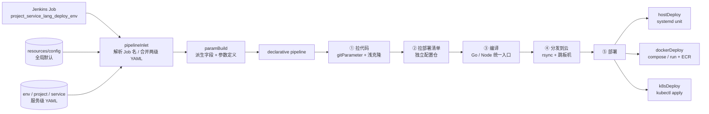

# pipeline · 配置驱动的 Jenkins 多环境发布共享库

> 用**一个 Job 名 + 一份 YAML**，把「多项目 × 多服务 × 多语言 × 多部署形态 × 多环境」的发布流程收敛到同一套 Jenkins Shared Library 里。


生产环境配置与部署清单**不在此仓库**（已外置），本仓库只包含流水线代码与脱敏后的示例配置。

---

## 为什么做这个

多套业务同时迭代时，最容易出现的问题是：每个服务一份 Jenkinsfile、编译命令各写一遍、发布脚本散落在不同 Job 里、改一个公共逻辑要改十几个地方。

这套共享库的做法是：

- **约定优于脚本**：Job 名即配置索引，`<项目>_<服务>_<语言>_<部署类型>_<环境>` 五段式，新增服务不需要写流水线代码；
- **配置两级覆盖**：全局默认 `resources/config/config.yaml` + 服务级 `<环境>/<项目>/<服务>/<job>.yaml`，后者同名 key 覆盖前者；
- **一套入口，三种落地**：编译产物统一打包，按 `DEPLOY` 自动分流到 `host`（systemd）/ `docker`（compose 或 run）/ `k8s`（apply + rollout）；
- **发布动作参数化**：发版、只改配置、灰度、指定主机、演练、纯重启，共用同一条流水线。

---

## 架构



主入口只有两行（`Jenkinsfile`），其余逻辑全部在 `vars/` 里以 Jenkins 全局 step 的形式提供：

```groovy
@Library('Shared-Library@main') _
def paramMap = pipelineInlet env.JOB_NAME
```

---

## 目录结构

```text
pipeline/
├── Jenkinsfile                 # 入口：加载共享库，调用 pipelineInlet
├── vars/                       # 14 个 Groovy 全局 step（共享库主体）
│   ├── pipelineInlet.groovy    #   流水线主体：参数定义 + 5 个 stage
│   ├── paramBuild.groovy       #   Job 名解析、配置校验、派生字段注入
│   ├── buildStage.groovy       #   Go / Node 统一编译与产物打包
│   ├── gitCheckout.groovy      #   GitSCM 单分支浅克隆、按 URL 前缀自动选凭据
│   ├── rsyncArtifacts.groovy   #   产物 / 配置分发
│   ├── hostDeploy.groovy       #   host 部署编排
│   ├── dockerDeploy.groovy     #   docker 部署编排（灰度 / 指定主机 / ECR）
│   ├── k8sDeploy.groovy        #   k8s 部署编排
│   ├── remote*.groovy          #   远端执行、镜像构建/推送、kubectl、systemd
│   └── ...
├── resources/
│   └── config/config.yaml      # 全局默认配置 + 字段字典（本仓库为脱敏示例值）
├── tools/gen-docs.ps1          # 配置驱动的文档生成器（-DryRun / -Check）
└── examples/demo-service.yaml  # 最小可跑的服务级配置示例
```

> `resources/<prod|test>/` 属于各环境的**私有部署配置**（含目标机与业务参数），按设计不纳入本仓库，见 `.gitignore`。

---

## 快速开始

### 1. 准备 Jenkins

| 依赖 | 用途 |
| --- | --- |
| `pipeline-utility-steps` | `readYaml` + `libraryResource` 读取两级 YAML |
| `git` / `git-parameter` | 代码检出、分支/标签下拉与快速过滤 |
| `ssh-credentials` / `credentials-binding` | `withCredentials` 注入 SSH 私钥，密钥不落盘 |
| `active-choices` | `reactiveChoice` 参数联动（MODE → 目标主机多选） |

在 **Manage Jenkins → Configure System → Global Pipeline Libraries** 添加共享库，名称 `Shared-Library`，默认版本 `main`，指向本仓库。

### 2. 建一个 Job

Job 名遵循五段式，例如 `demo_api_go_docker_prod`：

| 段 | 含义 | 示例 |
| --- | --- | --- |
| 项目 | 业务/项目名 | `demo` |
| 服务 | 服务名 | `api` |
| 语言 | `go` / `nodejs` | `go` |
| 部署类型 | `host` / `docker` / `k8s` | `docker` |
| 环境 | 对应 `resources/<env>/` | `prod` |

流水线选择 **Pipeline script from SCM**，指向本仓库的 `Jenkinsfile`。首次构建不弹参数，跑一次后参数页即可正常列出分支。

### 3. 写服务级配置

复制 `examples/demo-service.yaml` 到 `resources/<env>/<project>/<service>/<job>.yaml`，改成自己的仓库地址与目标机。全局默认值在 `resources/config/config.yaml`，按需覆盖。

### 4. 跑一次

先用 `MODE=test` 走全流程演练（产物分发到 `_test` 子目录，不实际发布），确认无误后再切 `MODE=deploy`。

---

## 发布模式

| MODE | 说明 |
| --- | --- |
| `deploy` | 正常发版：编译 → 分发 → 部署 |
| `config` | 只更新配置并重建/重启容器，沿用当前镜像，不重新构建 |
| `restart` | 纯重启，不拉部署清单、不编译、不分发 |
| `rollback` | 回滚入口（占位，按业务接入） |
| `Grayscale` | 灰度：只发布到 `gray_hosts` 指定的机器 |
| `custom` | 手动勾选 `TARGET_HOSTS` 中的目标机 |
| `test` | 全流程演练，产物进 `_test` 目录，不发布 |

`BRANCH` 由 `gitParameter` 从源码仓远端拉取分支/标签，`defaultValue` 取服务 YAML 的 `default_branch`；`TARGET_HOSTS` 由 `reactiveChoice` 依据 `MODE` 动态渲染多选。

---

## 工程细节

- **配置即代码**：`readYaml(libraryResource(...))` + `putAll` 两级合并，Job 名解析出全部上下文，新增服务零流水线代码。
- **凭据零落盘**：远端脚本统一走 `withCredentials([sshUserPrivateKey(...)])`，配置里只保存 Jenkins 凭据 ID；ECR 登录用 `get-login-password | docker login --password-stdin`。
- **构建细节**：Go 私有依赖通过 `GOPRIVATE` + `GIT_CONFIG_KEY_* insteadOf` 把 https 重写为 git@；Node 用 corepack/pnpm + `NODE_OPTIONS` 防 OOM；产物按 `node_type` 区分静态站与 `standalone` 常驻服务。
- **网络拓扑适配**：跳板机中转与直连双通道；`rsync` 分发、目标机 `docker save/load` 兜底（目标机无法访问镜像仓库时）。
- **可观测与幂等**：`timestamps()` + `disableConcurrentBuilds()`、构建标签时间戳化、历史镜像保留策略、k8s `rollout status` 等待。
- **文档即代码**：`tools/gen-docs.ps1` 从 Groovy 文件头注释与 YAML 抽取字段生成文档，`-Check` 可在 CI 中校验文档与代码是否同步。

---

## 安全约定

- `resources/prod/`、`resources/test/` 及任何 `*.key` / `.env` / `secrets/` 均不入库；
- 部署清单、k8s Secret、compose/Dockerfile 外置到独立配置仓，本仓库只持有流水线逻辑；
- `resources/config/config.yaml` 在本公开仓库中全部为**示例值**（`example.com`、示例 IP、示例账号 ID、示例凭据 ID），接入自有环境时请替换；
- 生产环境请勿直接复用示例值，凭据一律通过 Jenkins Credentials 管理。

## License

仅用于技术交流与作品展示；生产使用请在自有环境完成安全评估。
